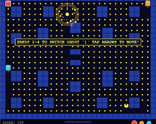

# The Soul of Pac-Man

Pac-Man, flipped. You control the ghosts and hunt an AI-controlled Pac-Man through the maze. Catch him before he eats every dot, but every 10 steps his soul jumps into another ghost's body.

**Project page:** https://cloudbv.github.io/the-soul-of-pacman/

**Play on itch.io:** https://cloudbv.itch.io/the-soul-of-pacman



## Run it

You need Python 3 and Pygame.

```bash
pip install pygame
python3 main.py
```

The window is 812 × 724 pixels.

## Goal

- **You win** when a ghost lands on Pac-Man's tile (or he steps onto a ghost): *you caught him!*
- **Pac-Man wins** when every dot is eaten: *pac-man wins!*

Ghosts eat dots as they walk too, so your moves count toward the dot total.

## Controls

| Key | Action |
|---|---|
| `1` – `4` | Take control of that ghost |
| Arrow keys | Tap to move your ghost one tile |
| `R` | Restart |

Switching ghosts adds a short 0.3 second delay before the new ghost can move. You can't walk through other ghosts or corpses.

## Soul transfer

1. After every 10 Pac-Man steps, his soul jumps. The HUD bar turns red for the last 4 steps and Pac-Man flashes red.
2. He possesses the ghost **farthest** from him (if it's more than 3 tiles away) and takes its tile.
3. His old body stays behind as a corpse. The closest other ghost within 5 tiles of the blast also becomes a corpse.
4. Corpses revive as ghosts after 5 Pac-Man moves.
5. Each transfer scores combo count × 100 points. The combo resets after about 3 seconds without another transfer.

## Ghost personalities

| Ghost | Color | Behavior |
|---|---|---|
| 1 | Red | **Aggressive:** shortest path to Pac-Man about 90% of the time |
| 2 | Orange | **Patrol:** wanders along its direction, chases within 5 tiles |
| 3 | Cyan | **Ambush:** aims 4 tiles ahead of Pac-Man's heading |
| 4 | Pink | **Random:** chases about 40% of the time, otherwise random |

## Pac-Man's AI

- **Flee:** with a ghost within 8 tiles, he picks the move that maximizes maze distance from all ghosts.
- **Hunt:** otherwise he heads to the nearest dot via breadth-first search.
- He never steps onto a ghost if he has a safe move.

## Under the hood

Everything is in one Python file: maze layout and helpers, BFS pathfinding, Pac-Man and ghost AI, soul transfer logic, effects (blast rings, particles, screen shake) and an async main loop that keeps it compatible with browser builds such as pygbag.

## Files

| File | Purpose |
|---|---|
| `main.py` | The whole game |
| `index.html` | Project page |
| `screenshot.png` | Screenshot used on the page and in this README |
